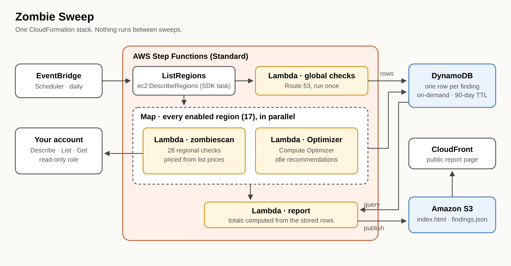

# Zombie Sweep

A daily serverless sweep of every enabled AWS region for resources nobody is using, and what they cost. Entry for the AWS Builder Center Weekend Challenge: No Pipeline, No Problem.

**Live report:** https://diomvue77lcq.cloudfront.net/

**Demo video:** https://youtu.be/pb8_4G7hu-M

On the account it was built on, Compute Optimizer returned no idle recommendations in any of 17 regions. The same sweep found 184 unused resources costing an estimated $11.92 a month, all of them resource types outside Compute Optimizer's idle list. One sweep costs $0.0026 and takes about 19 seconds.



| Path | What it does |
|---|---|
| `template.yaml` | The whole stack: Step Functions, three Lambda functions, DynamoDB, S3, CloudFront, EventBridge Scheduler, read-only IAM |
| `functions/scan_region.py` | Runs [zombiescan](https://github.com/xbill9/zombiescan)'s checks for one region and writes one row per finding |
| `functions/optimizer.py` | Reads Compute Optimizer idle recommendations for one region into the same table |
| `functions/report.py` | Totals the run from the stored rows and publishes `index.html` and `findings.json` |
| `deploy.sh` | Bundles the functions with zombiescan at a pinned commit and deploys the stack; `./deploy.sh run` starts a sweep and waits |
| `docs/evidence/` | Every figure quoted in the write-up, with the commands and prices behind it |

## Deploy

Requires the AWS CLI v2, `git` and `python3`. No SAM, CDK or build server.

```bash
./deploy.sh          # create or update the stack in us-east-1
./deploy.sh run      # sweep now instead of waiting for the schedule
```

The schedule defaults to 12:00 UTC daily (`Schedule` parameter). Compute Optimizer needs to be opted in for its half of the report, and looks back 14 days before it recommends anything.

## How it works

1. EventBridge Scheduler starts the state machine once a day.
2. `ListRegions` calls `ec2:DescribeRegions` directly from Step Functions, so opted-out regions are never scanned.
3. A Map state fans out over every region. Each region runs two Lambda functions side by side: zombiescan's 28 regional checks, and Compute Optimizer's idle recommendations. A third branch runs the 2 global Route 53 checks once.
4. Every finding becomes one DynamoDB row, keyed by run and source, with a 90-day TTL.
5. The report Lambda queries the run's rows and computes every total from them. The page and `findings.json` go to a private S3 bucket served through CloudFront.

The scan role can describe and list, never read contents: an explicit deny covers `secretsmanager:GetSecretValue`, `s3:GetObject`, ECR image pulls and Lightsail access details. The public page shortens resource names and ids; the full rows stay in DynamoDB.

The stack's own log groups carry a 14-day retention, so the sweep does not report itself.

## Cost

Measured from the second sweep's billed Lambda time and its 56 state transitions, at us-east-1 list prices without free tiers:

| Item | Per sweep |
|---|---|
| Step Functions | $0.00140 |
| Lambda | $0.00099 |
| DynamoDB, S3, CloudWatch Logs | $0.00019 |
| **Total** | **$0.0026** — $0.08 a month at one sweep a day |

Between sweeps the stack costs nothing to run beyond the stored report. `docs/evidence/cost_measured.py` has the arithmetic.

Estimates come from list prices, not your bill. The sweep is read-only and deletes nothing. Code is MIT, matching zombiescan.
