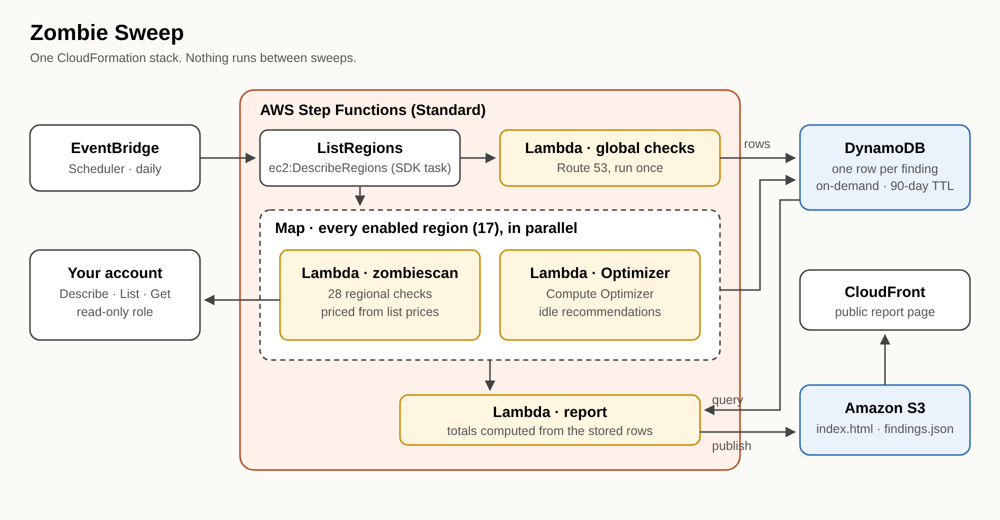

This article provides a step by step guide to building a daily sweep for unused AWS resources with AWS Step Functions, AWS Lambda, Amazon DynamoDB, Amazon S3 and Amazon CloudFront. Each region runs zombiescan's checks beside AWS Compute Optimizer's idle recommendations, and one report prices what both found.

Repository: https://github.com/xbill9/zombie-sweep

Live report: https://diomvue77lcq.cloudfront.net/

Demo video: https://youtu.be/pb8_4G7hu-M

---

#### What Is a Zombie Resource?

A zombie resource is something that still bills and no longer does any work. An Elastic IP attached to nothing, a container repository nobody has pushed to in months, a secret nobody reads, a hosted zone that resolves nothing.

They collect where nobody looks: in regions you used once, in stacks that were half deleted, in experiments that ended on a Friday.

---

#### Doesn't AWS Already Do This?

Partly. AWS Compute Optimizer gives idle recommendations for 12 resource types: EC2 instances, Auto Scaling groups, EBS volumes, ECS services on Fargate, RDS and Aurora, NAT gateways, provisioned DynamoDB tables, ElastiCache, MemoryDB, DocumentDB, WorkSpaces and SageMaker endpoints.

AWS Trusted Advisor has cost checks too, and they need a Business Support plan or higher.

Container images, AMIs, snapshots, secrets, hosted zones, log groups, security groups and VPC endpoints sit outside Compute Optimizer's list. Zombie Sweep runs both sources side by side, so the report shows what each one sees.

---

#### At This Point You Should Have

- An AWS account and the AWS CLI, version 2
- `git` and `python3` on the machine that deploys
- Compute Optimizer opted in, for its half of the report

No AWS SAM, AWS CDK or build server is needed.

---

#### How It Fits Together



EventBridge Scheduler starts a Step Functions state machine once a day. The state machine lists the account's regions, fans out to all of them, and hands the results to a report function. Nothing runs between sweeps.

---

#### Step 1 — List the Regions From Step Functions

Step Functions calls `ec2:DescribeRegions` directly as an AWS SDK task, with no Lambda function in between. Regions the account has opted out of are left out by AWS, so they are never scanned.

```yaml
ListRegions:
  Type: Task
  Resource: arn:aws:states:::aws-sdk:ec2:describeRegions
  Parameters: {}
  ResultSelector:
    regions.$: $.Regions[*].RegionName
  ResultPath: $.list
  Next: Sweep
```

---

#### Step 2 — Fan Out, Two Functions per Region

A Map state runs every region at once. Inside each iteration, a Parallel state starts two Lambda functions: one runs zombiescan's 28 regional checks, the other reads Compute Optimizer's idle recommendations for that region. A third branch runs the 2 global Route 53 checks once, so a hosted zone is counted once.

```yaml
EachRegion:
  Type: Map
  ItemsPath: $.list.regions
  MaxConcurrency: 0
  ItemSelector:
    runId.$: $$.Execution.Name
    region.$: $$.Map.Item.Value
  ItemProcessor:
    ProcessorConfig: { Mode: INLINE }
    StartAt: BothSources
```

The scan function bundles zombiescan's engine at a pinned commit and calls it for one region:

```python
checks = [c for c in engine.select_checks(()) if c.is_global == want_global]
result = engine.scan(boto3.Session(), [region], checks, PRICING, max_workers=8)
```

---

#### Step 3 — One Row per Finding

Both functions write to the same DynamoDB table in the same shape, keyed by run and by source:

```text
runId = 5cae23e0-...                      (the Step Functions execution name)
sk    = zombiescan#us-east-1#unused-ami#ami-...
sk    = compute-optimizer#us-east-1#EBSVolume#vol-...
```

The table is on-demand, so it costs nothing between sweeps, and every row carries a 90-day TTL.

---

#### Step 4 — Read the Shape of Things, Never Their Contents

The scan role allows `Describe*`, `List*` and a short list of `Get*` calls. An explicit deny closes the calls that would read data:

```yaml
- Sid: NoSecretsOrData
  Effect: Deny
  Action:
    - secretsmanager:GetSecretValue
    - s3:GetObject
    - lightsail:GetInstanceAccessDetails
    - lightsail:GetRelationalDatabaseMasterUserPassword
    - ecr:GetAuthorizationToken
    - ecr:GetDownloadUrlForLayer
    - ecr:BatchGetImage
  Resource: "*"
```

The stale-secret check reads when a secret was last retrieved from `DescribeSecret`. It never needs the value.

---

#### Step 5 — Totals in Code, Report on S3

The report function queries the run's rows and computes every total from them: per source, per check, and the share that falls on resource types outside Compute Optimizer's list. It writes `index.html` and `findings.json` to a private S3 bucket behind CloudFront.

The page is public, so resource names and ids are shortened on it. The full rows stay in DynamoDB, which only the account can read.

---

#### 🔎 Tip: Declare Your Own Log Groups

Lambda and Step Functions create log groups that keep data forever unless told otherwise. The sweep's own checks flag that, so the template declares every log group with a 14-day retention:

```yaml
ScanLogs:
  Type: AWS::Logs::LogGroup
  Properties:
    LogGroupName: !Sub "/aws/lambda/${AWS::StackName}-scan"
    RetentionInDays: 14
```

On the account it was built on, 120 other log groups had no retention set.

---

#### Step 6 — Deploy With One Script

`deploy.sh` bundles the three handlers with zombiescan, uploads the bundle under a name derived from its hash, and runs `aws cloudformation deploy`:

```bash
./deploy.sh
```

```text
bundle s3://zombie-sweep-code-...-us-east-1/bundle-a23bc964e7caaeb2.zip (96K)
Waiting for changeset to be created..
Waiting for stack create/update to complete
Successfully created/updated stack - zombie-sweep
```

`./deploy.sh run` starts a sweep and waits for it:

```text
{
    "status": "SUCCEEDED",
    "start": "2026-11-15T10:48:45.543000-05:00",
    "stop": "2026-11-15T10:49:04.580000-05:00",
    "output": "{\"runId\":\"b974c166-bd60-4e13-87f2-93aaa18af95a\",\"findings\":184,\"monthlyCost\":11.92,\"outsideComputeOptimizerTypes\":{\"findings\":184,\"monthlyCost\":11.92},\"foundByBoth\":0}"
}
```

Seventeen regions, 35 Lambda invocations, no errors, 19 seconds end to end.

---

#### What the Sweep Found

Compute Optimizer returned no idle recommendations in any of the 17 regions. zombiescan found 184 resources:

| Check | Findings | Monthly |
| --- | --- | --- |
| ecr-stale-images | 35 | $6.62 |
| unused-ami | 1 | $4.00 |
| stale-secret | 2 | $0.80 |
| unused-route53-zone | 1 | $0.50 |
| log-group-no-retention | 120 | $0.00 |
| unused-security-group | 24 | $0.00 |
| empty-vpc | 1 | $0.00 |

That is $11.92 a month, and all 184 findings are resource types outside Compute Optimizer's idle list. The zero-dollar rows cost nothing today and are still clutter: an unbounded log group grows its bill with every write.

---

#### Compare and Contrast

| | Compute Optimizer | Trusted Advisor cost checks | Zombie Sweep |
| --- | --- | --- | --- |
| Resource types | 🥈 12, compute and databases | broader | 🥇 30 checks incl. ECR, AMIs, secrets, logs |
| Support plan | 🥇 any | ❌ Business or higher | 🥇 any |
| Per-resource dollar figure | 🥇 yes | partial | 🥇 yes, list prices |
| Lookback | 14 days of metrics | AWS-side | current state |
| Runs where | AWS-side | AWS-side | your account, daily |

---

#### What Does It Cost?

Measured from the run above: billed Lambda time from each function's log, 56 state transitions, and us-east-1 list prices from the AWS Price List API, without free tiers.

| Item | Per sweep |
| --- | --- |
| Step Functions | $0.00140 |
| Lambda (arm64) | $0.00099 |
| DynamoDB, S3, CloudWatch Logs | $0.00019 |
| **Total** | **$0.0026** |

At one sweep a day that is $0.08 a month, against $11.92 a month of waste found. Between sweeps nothing runs.

---

#### So, Which One?

Keep Compute Optimizer on: it watches utilisation over weeks, which a point-in-time scan cannot. Add a sweep for everything outside its list. Running both in one Step Functions execution puts the two answers in one table, priced the same way, and shows which source found each item.

---

#### Summary

The goal of this article was to find unused AWS resources every day across every region for close to nothing. The key to the solution was a Step Functions Map state that runs zombiescan's checks beside Compute Optimizer in Lambda and keeps the totals in code. The results on one account were:

- 🟢 17 regions swept in 19 seconds, 35 Lambda invocations, no errors
- 🟢 184 unused resources found, an estimated $11.92 a month
- ⚠️ Compute Optimizer returned no idle recommendations; all 184 findings are types outside its list
- 🟢 $0.0026 per sweep, measured

Scope: one AWS account with 17 enabled regions, swept on 2026-11-15. Costs are estimates from AWS list prices and exclude Secrets Manager and KMS per-call charges and CloudFront delivery. Compute Optimizer had been opted in for a month. The sweep is read-only and deletes nothing.

The strategy for using Step Functions and Lambda for a daily waste sweep was validated with an incremental step by step approach.

#### References

- [Live report](https://diomvue77lcq.cloudfront.net/)
- [Code on GitHub](https://github.com/xbill9/zombie-sweep)
- [zombiescan](https://github.com/xbill9/zombiescan)
- [Compute Optimizer idle recommendations](https://docs.aws.amazon.com/compute-optimizer/latest/ug/view-idle-recommendations.html)
- [AWS Trusted Advisor](https://docs.aws.amazon.com/awssupport/latest/user/trusted-advisor.html)
- [Step Functions AWS SDK integrations](https://docs.aws.amazon.com/step-functions/latest/dg/supported-services-awssdk.html)
